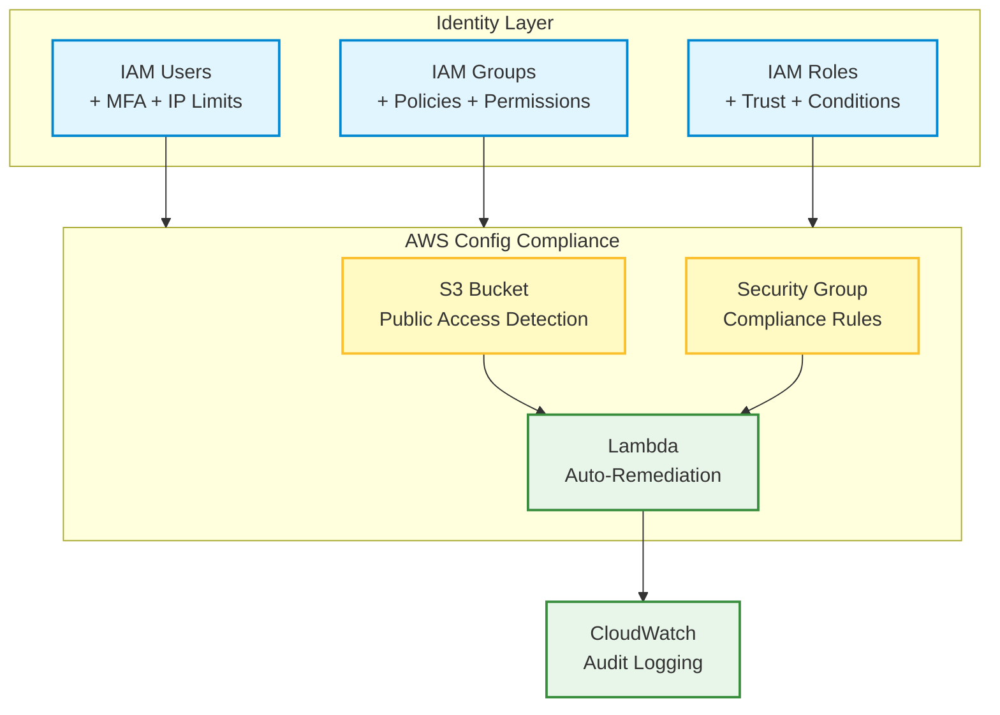
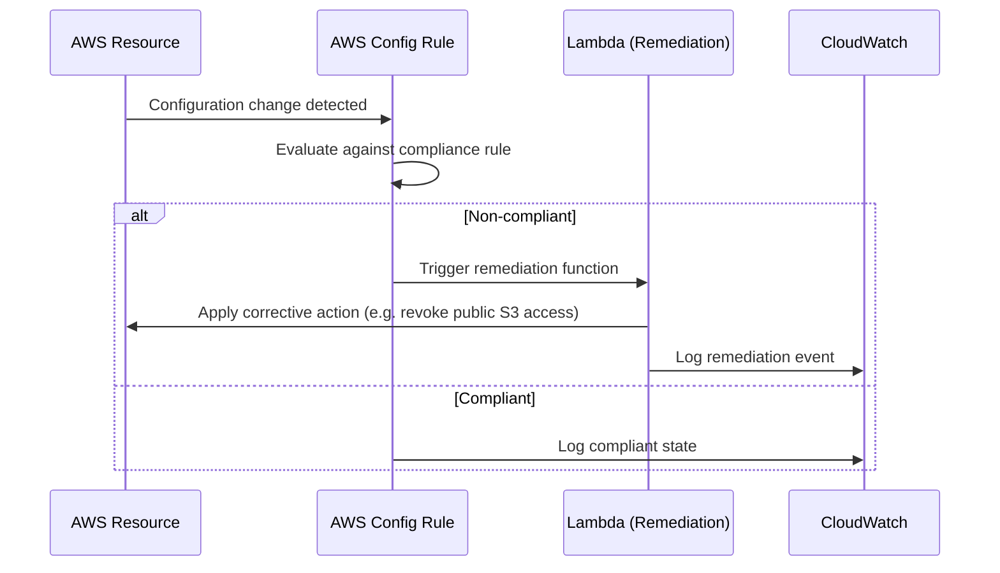

# 🔐 IAM & Zero Trust Security Implementation

Enterprise-grade IAM implementation with Zero Trust security model, automated compliance monitoring, and self-healing infrastructure

## 🎯 Project Overview

This project demonstrates advanced AWS Identity and Access Management (IAM) implementation following Zero Trust security principles. It includes automated compliance monitoring with AWS Config, self-healing Lambda functions, and comprehensive access controls that enforce least privilege access with contextual conditions.

## 🏆 Key Achievements

- ✅ Zero Trust IAM - Never trust, always verify with contextual access controls
- ✅ Automated Compliance - AWS Config rules with auto-remediation
- ✅ Least Privilege Access - Minimal necessary permissions with IP restrictions
- ✅ MFA Enforcement - Multi-factor authentication for all users
- ✅ Self-Healing Infrastructure - Lambda functions for automated remediation

## 🏗️ Architecture Diagram



## 🔄 Self-Healing Compliance Flow



## 🚀 Features & Technologies

### 🔒 Zero Trust Security Features
- Contextual Access Control - IP-based access restrictions
- MFA Enforcement - Multi-factor authentication for all users
- Least Privilege Policies - Minimal necessary permissions
- Conditional Access - Time and location-based restrictions
- Role-Based Access Control (RBAC) - Granular permission management

### 🛠️ AWS Services Integration
- IAM - Users, Groups, Roles, and Policies
- AWS Config - Compliance monitoring and drift detection
- Lambda - Automated remediation functions
- CloudWatch - Logging and monitoring
- S3 - Secure storage with compliance rules

### 📊 Compliance & Monitoring
- Automated Compliance Checks - Real-time policy violations detection
- Self-Healing Infrastructure - Automatic remediation of non-compliant resources
- Audit Logging - Complete access and configuration change tracking
- Policy Enforcement - Automated policy application and monitoring

## 🏃‍♂️ Quick Start

### Prerequisites
- Terraform >= 1.7
- AWS CLI configured
- AWS Account with IAM and Config permissions

### 🚀 Deployment

**Clone and Navigate**
```bash
git clone <your-repo>
cd iam-zero-trust
```

**Configure Variables**
```bash
# Edit terraform.tfvars
vim terraform.tfvars
```

**Deploy Infrastructure**
```bash
# Initialize Terraform
terraform init

# Plan deployment
terraform plan

# Apply changes
terraform apply -auto-approve
```

**Verify Deployment**
```bash
# Check IAM users
aws iam list-users

# Check Config rules
aws configservice describe-config-rules

# Check Lambda functions
aws lambda list-functions
```

### 🧹 Cleanup
```bash
terraform destroy -auto-approve
```

## 🤖 CI/CD Pipeline

This repository includes a GitHub Actions workflow (`.github/workflows/terraform-ci.yml`) that automatically runs on pushes and pull requests to `master` or `main`.

The pipeline performs:
- **Terraform Linting**: Checks formatting consistency using `terraform fmt -check`.
- **Terraform Validation**: Validates the Terraform configuration syntax and schema.
- **Security Auditing**: Integrates Aqua Security's **Trivy** scan to detect high/critical severity security risks and misconfigurations in the IAM policies, trust relationships, and bucket policies.

## 💰 Cost Analysis

| Resource | Monthly Cost | Purpose |
|---|---|---|
| AWS Config | ~$2-5 | Compliance monitoring |
| Lambda Functions | ~$0.20 | Auto-remediation |
| CloudWatch Logs | ~$1-3 | Audit logging |
| S3 Storage | ~$0.50 | Config snapshots |
| **Total** | **~$4-9** | Complete Zero Trust IAM |

💡 **Cost Optimization**: Most IAM resources are free; costs are minimal for monitoring and automation

## 🔧 Configuration

### Variables (terraform.tfvars)
```hcl
# Project Configuration
project_name = "iam-zero-trust"
environment = "dev"

# Corporate IP Range (for access restrictions)
corporate_ip_range = "203.0.113.0/24"

# IAM Configuration
admin_users = ["admin1", "admin2"]
developer_users = ["dev1", "dev2"]
readonly_users = ["readonly1", "readonly2"]

# MFA Configuration
mfa_enforcement = true
```

### IAM Policies
- **Admin Policy** - Full access with MFA requirement
- **Developer Policy** - Limited access to dev resources
- **ReadOnly Policy** - Read-only access across services
- **S3 Policy** - Bucket-specific permissions with IP restrictions

## 📁 Project Structure

```
iam-zero-trust/
├── versions.tf                 # Terraform and provider versions
├── providers.tf                # AWS provider configuration
├── variables.tf                # Input variables
├── iam-users.tf                # IAM users with MFA
├── iam-groups.tf               # IAM groups and memberships
├── iam-policies.tf             # Custom IAM policies
├── iam-roles.tf                # IAM roles and trust policies
├── aws-config.tf                # AWS Config rules and compliance
├── lambda-remediation.tf       # Auto-remediation Lambda functions
├── outputs.tf                  # Terraform outputs
└── README.md                   # This file
```

## 🎓 Learning Outcomes

This project demonstrates mastery of:

### 🔐 Identity & Access Management
- IAM Best Practices - Users, groups, roles, and policies
- Zero Trust Principles - Never trust, always verify
- Conditional Access - Context-aware access controls
- MFA Implementation - Multi-factor authentication enforcement

### 📊 Compliance & Governance
- AWS Config - Configuration compliance monitoring
- Automated Remediation - Self-healing infrastructure
- Policy as Code - Infrastructure and security policies
- Audit Logging - Complete access and change tracking

### 🛠️ Automation & DevOps
- Lambda Functions - Serverless automation
- Terraform - Infrastructure as Code
- Event-Driven Architecture - Config rule triggers
- Monitoring - CloudWatch integration

### 🏢 Enterprise Security
- Least Privilege Access - Minimal necessary permissions
- Network Segmentation - IP-based access controls
- Compliance Frameworks - SOC 2, PCI-DSS alignment
- Security Monitoring - Real-time threat detection

## 🚀 Future Enhancements
- Single Sign-On (SSO) - AWS SSO integration
- Advanced Analytics - Access pattern analysis
- Threat Detection - GuardDuty integration
- Compliance Reporting - Automated compliance reports
- Cross-Account Access - Multi-account IAM management
- API Gateway - Secure API access controls

## 🤝 Contributing
1. Fork the repository
2. Create a feature branch (`git checkout -b feature/amazing-feature`)
3. Commit your changes (`git commit -m 'Add amazing feature'`)
4. Push to the branch (`git push origin feature/amazing-feature`)
5. Open a Pull Request

## 📄 License
This project is licensed under the MIT License - see the LICENSE file for details.

## 👨‍💻 Author
**Mihir Ajmera** — GRC Engineer & Cloud Security

- LinkedIn: [Mihir Ajmera](https://linkedin.com/in/mihirajmera)
- GitHub: [Mihirajmera](https://github.com/Mihirajmera)
- Email: ajmera.mihir.79@gmail.com

⭐ Star this repository if you found it helpful!

*This project showcases enterprise-level IAM and Zero Trust security implementation — demonstrating security architecture expertise for technical interviews.*
